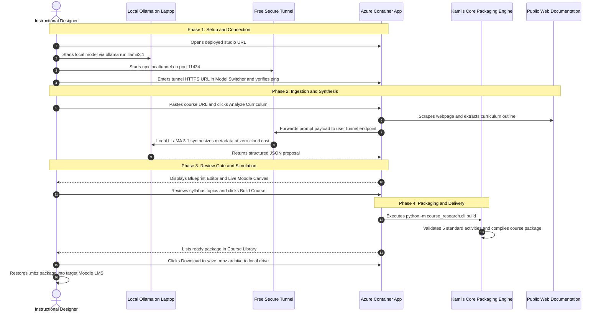
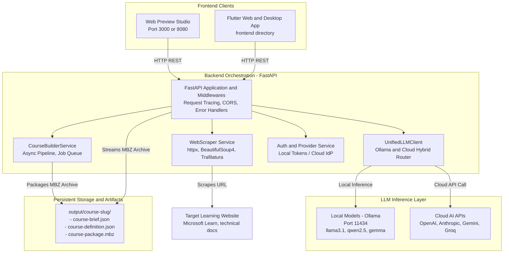
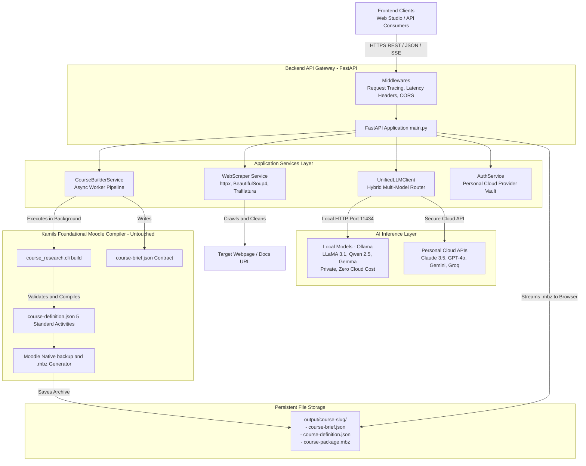

# LMS01 FX Learning Agent - System Architecture & Operations Manual

## 1. Executive Overview

The **FX Learning Agent (FusionAIx Moodle Studio)** is an enterprise AI-powered course generation platform that transforms raw web documentation, technical articles, and curriculum URLs into production-ready, native Moodle 5.x course backup archives (`.mbz`).

The platform incorporates:
- An **Interactive Human Review Gate** where instructional designers inspect and fine-tune AI-derived course metadata before packaging.
- A **Dual-Pane Live Preview Canvas** that simulates the student learner experience in Moodle 5.x in real time.
- A **Hybrid LLM Execution Engine** supporting local open-source models via Ollama (zero-cost, private, offline) as well as personal cloud LLMs (Claude, OpenAI, Gemini, Groq).

---

## 2. Collaborative Engineering Breakdown: Kamil & Abdus

The platform is built on two complementary engineering pillars that work seamlessly together: **Kamil's Foundational Moodle Engine** (the low-level course compiler) and **Abdus's Full-Stack Web Platform** (the user interface, asynchronous API services, multi-model router, and cloud deployment).

### 2.1 Complete 7-Step End-to-End Workflow

```
[ USER in Web Studio ]
        │
        ▼ (Step 1: Paste URL)
[ WebScraper Service ] ──────► Crawls & cleans public web page
        │
        ▼ (Step 2: Synthesize)
[ Unified LLM Router ] ──────► Local Ollama (LLaMA/Qwen) OR Cloud (Claude/OpenAI/Gemini)
        │
        ▼ (Step 3: Human Approval)
[ Review Gate & Canvas ] ────► User verifies modules & sees live Moodle preview
        │
        ▼ (Step 4: Click "Build Course")
[ CourseBuilder Engine ] ────► Writes output/<slug>/course-brief.json
        │
        ▼ (Step 5: Kamil's Core Engine - UNTOUCHED)
[ course_research.cli ] ─────► Compiles & validates output/<slug>/course-definition.json
        │
        ▼ (Step 6: Native Moodle Bundler)
[ .mbz Packager Engine ] ────► Generates output/<slug>/course-package.mbz
        │
        ▼ (Step 7: 1-Click Delivery)
[ Course Library Tab ] ──────► Direct browser download (no File Explorer / SSH needed)
```

---

### 2.2 Kamil's Foundational Work (Core Moodle Packaging Engine)
Kamil designed and built the robust, low-level course packaging engine that interacts directly with Moodle's native backup formats:
1. **Core Data Schemas (`course_research/`)**: Developed the Pydantic v2 schemas (`CourseBrief` and `CourseDefinition`) that establish the 5 standard Moodle learning activities:
   * Activity 1: Course Overview & Learning Outcomes
   * Activity 2: Official Source Documentation Link
   * Activity 3: Video References
   * Activity 4: Assessment Quiz & Knowledge Check
   * Activity 5: Discussion Forum
2. **Moodle 5.x Packaging & Verification Environment (`docker/moodle/` & `bin/`)**: Set up the containerized MariaDB database seed, clean Moodle test instance, and low-level bash tooling (`bin/course-definition` and `bin/course-package`) that package and verify native `.mbz` backup tarballs.
3. **Domain Contracts & Quality Checks**: Formulated the strict schema rules that ensure every generated course restores without XML errors in standard Moodle LMS installations.

---

### 2.3 Abdus's Work (Full-Stack Web Studio, Multi-Model AI & Cloud Deployment)
Abdus built the modern, full-stack application layer around Kamil's foundational engine, turning it into a visual, self-service enterprise platform accessible to all users:

1. **Enterprise Web Studio Frontend (`web_preview/`)**:
   * **Visual Interface**: Designed and built the Web Studio UI using the best enterprise design practices and responsive components.
   * **Interactive Review Gate**: Created the blueprint editor form paired with a **Live Simulated Moodle 5.x Canvas**, allowing instructional designers to preview the exact learner experience in real-time before compiling.
   * **Course Library**: Built the real-time course catalog with instant keyword search, difficulty level filter pills, collapsible activity inspector, and direct 1-click `.mbz` browser download (eliminating the need for SSH or File Explorer).
   * **Model Switcher Modal**: Built the provider management dialog supporting live SSE diagnostic tests.

2. **Asynchronous FastAPI Backend Orchestration (`backend/`)**:
   * **REST API Layer (`app/main.py`)**: Built the complete REST API (`/api/analyze-urls`, `/api/jobs`, `/api/courses`, `/api/download/{id}.mbz`, `/health`) with structured JSON logging, UUID tracing, and CORS.
   * **Autonomous Pipeline Engine (`app/services/course_builder.py`)**: Seamlessly connects to Kamil's core engine, programmatically generating course briefs and running `course_research.cli` in non-blocking background workers without requiring manual terminal commands.
   * **Automated Web Scraper (`app/services/scraper.py`)**: Built the automated scraper extracting clean curriculum outlines from documentation URLs.

3. **Unified Multi-LLM Router (`app/services/llm_client.py`)**:
   * **Zero Cloud GPU Cost Support**: Enabled support for free, offline local open-source models (Ollama: LLaMA 3.1, Qwen 2.5 Coder) optimized for standard 16GB laptops.
   * **Multi-Provider Flexibility**: Integrated support for personal cloud accounts (Anthropic Claude 3.5 Sonnet, OpenAI GPT-4o, Google Gemini, and Groq) so users can choose whichever AI model they prefer.

4. **Production Containerization & Azure Cloud Deployment**:
   * **Dockerization**: Authored the production monolithic `Dockerfile` packaging FastAPI and the Web Studio on port `8080`.
   * **Azure Container Apps**: Deployed the live container as **`fx-moodle-studio`** in `karthik-playground-rg` (`swedencentral`) with external HTTPS ingress.
   * **CI/CD**: Configured GitHub Actions automation (`.github/workflows/deploy-containerapp.yml`).

---

## 3. End-to-End Workflow with Open-Source Models (From Deployed Azure Link)

This section details how an end-user runs **100% free, private open-source models** (such as LLaMA 3.1 or Qwen 2.5) on their local machine or self-hosted endpoint while accessing the live **deployed Azure cloud application** with zero cloud GPU expenses.

### 3.1 Network Architecture & Sequence

Because the production application is deployed in a cloud container (Azure Container Apps in Sweden Central), it cannot directly resolve `localhost:11434` on a user's private laptop without a public ingress bridge. The user simply runs a lightweight, zero-cost tunnel (`localtunnel` or `ngrok`), or provides a self-hosted cloud Ollama/vLLM URL.



### 3.2 Step-by-Step Execution Guide

#### Step 1: Open the Deployed Azure Application
Access the production application in any browser:
* **Live Studio Link:** `https://fx-moodle-studio.bravewater-f333a261.swedencentral.azurecontainerapps.io/`

#### Step 2: Start Local Open-Source Model on Your Laptop
On your local machine (16GB RAM recommended):
1. Open terminal and run your preferred model:
   ```bash
   ollama run llama3.1:latest
   ```
2. In a second terminal window, expose the local Ollama port to a temporary HTTPS address:
   ```bash
   npx localtunnel --port 11434
   ```
   *(Alternative: `ngrok http 11434`)*
3. Copy the generated HTTPS tunnel URL (e.g. `https://fair-lion-42.loca.lt`).
   *(Note: If you have a self-hosted cloud VM running Ollama or vLLM, you can directly use its public IP or domain name without localtunnel).*

#### Step 3: Connect Model in Web Studio
1. In FX Moodle Studio, click the **Model Switcher** (Settings icon) in the top-right navigation bar.
2. In the **Local Host Endpoint** box, replace `http://localhost:11434` with your HTTPS tunnel URL.
3. Click **Retest Ping**. All 3 diagnostic health checks (Host reachable, Model verified, Neural PONG received) will pass and turn green.

#### Step 4: Analyze Learning URL
1. Navigate to the **Create Course** tab.
2. Paste any public curriculum or documentation link (e.g., Microsoft Learn, official technical docs).
3. Click **Analyze Curriculum**.
4. The Azure backend extracts the webpage content, sends the text payload through your tunnel directly to your local LLaMA 3.1 model, and receives the structured course outline with zero cloud GPU billing.

#### Step 5: Review Gate & Live Canvas Simulation
1. The application automatically advances to the **Review Gate** tab.
2. On the left pane (Blueprint Editor), review and adjust course title, difficulty level, target audience, and curriculum modules.
3. On the right pane, observe the **Live Simulated Moodle 5.x Canvas** dynamically reflecting your edits.
4. Click **Build Moodle Package**.

#### Step 6: Native Packaging via Kamil's Core Engine
1. The backend writes the verified specifications to `output/<course-slug>/course-brief.json`.
2. It programmatically executes Kamil's foundational `course_research.cli build` engine to generate `course-definition.json` with the 5 standard Moodle activities (Overview, Documentation URL, Videos, Assessment Quiz, Discussion Forum).
3. It packages the native `course-package.mbz` archive.

#### Step 7: 1-Click Browser Download & Moodle Restoration
1. Navigate to the **Course Library** tab.
2. Filter or search for your newly compiled course.
3. Click **Inspect Modules** to verify the learning activity tree.
4. Click **Download .mbz** to download the archive directly in your browser.
5. In your target Moodle LMS, navigate to **Site administration → Courses → Restore course** and upload the downloaded file.

---

## 4. High-Level Architecture Diagram



---

## 5. Frontend Architecture

### 5.1 Technology Stack
- **Framework**: Semantic HTML5, Modular CSS Design System, Vanilla ES6 JavaScript.
- **Design Tokens**: FusionAIx Obsidian & Slate Dark Theme (`--bg-black: #000000`, `--card-bg: #111111`, `--border: #262626`, `--accent-green: #05A357`, `--accent-blue: #276EF1`).
- **Typography**: Google Fonts (*Plus Jakarta Sans* & *JetBrains Mono*).

### 5.2 Navigation & Layout Hierarchy
1. **Centered Header Navigation**:
   - **Left Wing**: Brand badge (`fusionAIx` logo + `Moodle Studio` pill).
   - **Center Segmented Control**: 4 tabs centered using balanced flex wings:
     - `Create Course` (`#view-input`)
     - `Review Gate` (`#view-review`)
     - `Build Tracker` (`#view-progress`)
     - `Course Library` (`#view-library`)
   - **Right Wing**: Live AI Model Switcher button with real-time status beacon.

2. **Core Views**:
   - **Create Course Tab**: URL input, batch URLs input, Excel/CSV spreadsheet upload, provider settings.
   - **Review Gate Tab (Dual-Pane Layout)**:
     - **Left Pane (Blueprint Editor)**: Compact, high-density form fields for Course Title, Overview, Duration, Learner Level (Beginner / Intermediate / Advanced), Target Audience, and Curriculum Module chips.
     - **Right Pane (Live Moodle 5.x Canvas)**: Simulated LMS student course player with window controls, breadcrumbs, pulsing live sync indicator, Course Hero banner, and Moodle activity cards (Page, Resource, Book, Assignment, Forum).
   - **Build Tracker Tab**: Dynamic 5-stage progress meter and real-time telemetry console.
   - **Course Library Tab**: Real-time disk inventory scanning `output/`, client-side multi-facet search/filtering, and direct `.mbz` download links.

---

## 6. Backend Architecture

### 6.1 High-Level Backend Architecture Diagram



### 6.2 Technology Stack
- **Runtime**: Python 3.10+
- **Web Framework**: FastAPI & Starlette
- **ASGI Server**: Uvicorn
- **HTTP Client**: HTTPX (async)
- **HTML Parsing**: BeautifulSoup4, Trafilatura
- **Data Validation**: Pydantic v2 schemas

### 6.3 Core Service Components

| Service | File Location | Responsibility |
| :--- | :--- | :--- |
| **FastAPI Core** | `backend/app/main.py` | API endpoints, CORS, request tracing middleware with UUIDs, health probes. |
| **WebScraper** | `backend/app/services/scraper.py` | Extracts syllabus, headings, duration, and text from public course URLs with resilient fallbacks. |
| **UnifiedLLMClient** | `backend/app/services/llm_client.py` | Hybrid client routing between local Ollama (`http://localhost:11434`) and Cloud APIs. |
| **CourseBuilderService**| `backend/app/services/course_builder.py` | Asynchronous job runner creating course briefs, definitions, and native `.mbz` bundles. |
| **AuthService** | `backend/app/services/auth_service.py` | Manages connection status for OpenAI, Claude, Gemini, and Groq personal accounts. |

### 6.4 REST API Endpoints Reference

```http
# Health & Monitoring Probes
GET  /health                      # Basic service health
GET  /health/readiness            # K8s readiness probe (checks LLM and storage)
GET  /health/liveness             # K8s liveness probe

# Course Analysis & Proposals
POST /api/analyze-urls            # Scrapes URL and returns AI course proposal
POST /api/upload-spreadsheet      # Extracts URLs from .xlsx/.csv and analyzes

# Generation Pipeline Jobs
POST /api/jobs                    # Trigger background .mbz build job
GET  /api/jobs/{job_id}           # Poll job status, progress, and logs
POST /api/jobs/batch              # Trigger batch build for multiple proposals

# Course Package Library & Downloads
GET  /api/courses                 # List all completed packages from output/
GET  /api/download/{slug}.mbz     # Stream binary Moodle .mbz archive

# Engine & Model Configuration
GET  /api/config/llm              # Get active LLM provider, model, and Ollama tags
POST /api/config/llm              # Update active LLM model or provider at runtime
POST /api/test/llm                # Test connectivity to active LLM
```

---

## 7. How to Access and Run the System Locally

### 7.1 Prerequisites
- Python 3.10+ installed
- Node.js or Python `http.server` for serving the web preview
- Git

### 7.2 Step 1: Install Backend Dependencies
Open your terminal in the repository root:
```bash
# Navigate to backend directory
cd backend

# Create and activate a virtual environment (optional but recommended)
python -m venv venv
# Windows:
venv\Scripts\activate
# Linux/macOS:
# source venv/bin/activate

# Install required packages
pip install -r requirements.txt
```

### 7.3 Step 2: Start the FastAPI Backend
```bash
# Start backend on port 8088
python -m uvicorn app.main:app --host 0.0.0.0 --port 8088 --reload
```
- **Backend API**: `http://localhost:8088`
- **Interactive Swagger Docs**: `http://localhost:8088/docs`
- **Health Check**: `http://localhost:8088/health`

### 7.4 Step 3: Start the Web Preview UI
In a separate terminal:
```bash
# Serve the web_preview directory on port 3000
python -m http.server 3000 --directory web_preview
```
- **Web UI URL**: `http://localhost:3000`

---

## 8. How to Install and Configure Local Models (Ollama)

The system default is configured to use **local open-source models** through **Ollama**. Local execution provides:
- **100% Data Privacy**: No curriculum content or prompts leave your machine.
- **Zero Cloud Cost**: Completely free and offline-capable.
- **Fast Local Latency**: Ideal for workstations with GPUs or unified memory (Apple Silicon / NVIDIA RTX).

### 8.1 Step 1: Install Ollama
Download and install Ollama for your operating system:
- **Windows**: Download the installer from [ollama.com/download/windows](https://ollama.com/download/windows) and run setup.
- **macOS**: Download from [ollama.com/download/mac](https://ollama.com/download/mac) or install via Homebrew:
  ```bash
  brew install ollama
  ```
- **Linux**:
  ```bash
  curl -fsSL https://ollama.com/install.sh | sh
  ```

### 8.2 Step 2: Download and Run Recommended Models
Open PowerShell, Command Prompt, or Terminal, and run one or more of the following:

#### Recommended General Model (Balanced Speed & Quality)
```bash
ollama run llama3.1:latest
```

#### Lightweight Model (Ideal for laptops with 8GB RAM)
```bash
ollama run llama3.2:latest
```

#### High-Precision Coding & Technical Model
```bash
ollama run qwen2.5-coder:14b
```

#### Google Open Weights Model
```bash
ollama run gemma2:9b
```

### 8.3 Step 3: Verify Ollama is Running
Check that the local Ollama server is responding:
```bash
curl http://localhost:11434/api/tags
```
You will receive a JSON list of installed local models.

### 8.4 Step 4: Configure Backend Environment Variables
Create or update your `.env` file in `backend/.env`:
```env
# LLM Provider Configuration
LLM_PROVIDER=local
LLM_LOCAL_BASE_URL=http://localhost:11434
LLM_MODEL=llama3.1:latest
LLM_TIMEOUT=60.0

# Server Configuration
PORT=8088
LOG_LEVEL=INFO
```

### 8.5 Step 5: Switch Models Live from the UI
You can switch active models without restarting the server:
1. Open the UI at `http://localhost:3000`.
2. Click the model pill in the top-right corner of the navigation bar (e.g., `llama3.1:latest ▾`).
3. Select any installed local model detected from your Ollama instance.
4. Click **Apply Settings**. The backend immediately routes new course extraction requests through that model.

---

## 9. Storage & Output Directory Structure

Generated course artifacts are persisted in the `output/` directory in accordance with repository standards:

```
output/
├── <course-slug-1>/
│   ├── course-brief.json          # High-level curriculum syllabus & metadata
│   ├── course-definition.json     # Full Moodle activity specification
│   └── course-package.mbz         # Native, restorable Moodle 5.x backup archive
└── <course-slug-2>/
    ├── course-brief.json
    ├── course-definition.json
    └── course-package.mbz
```

Each course package can be restored directly into any standard Moodle 4.x / 5.x instance via **Course Administration > Restore**.
