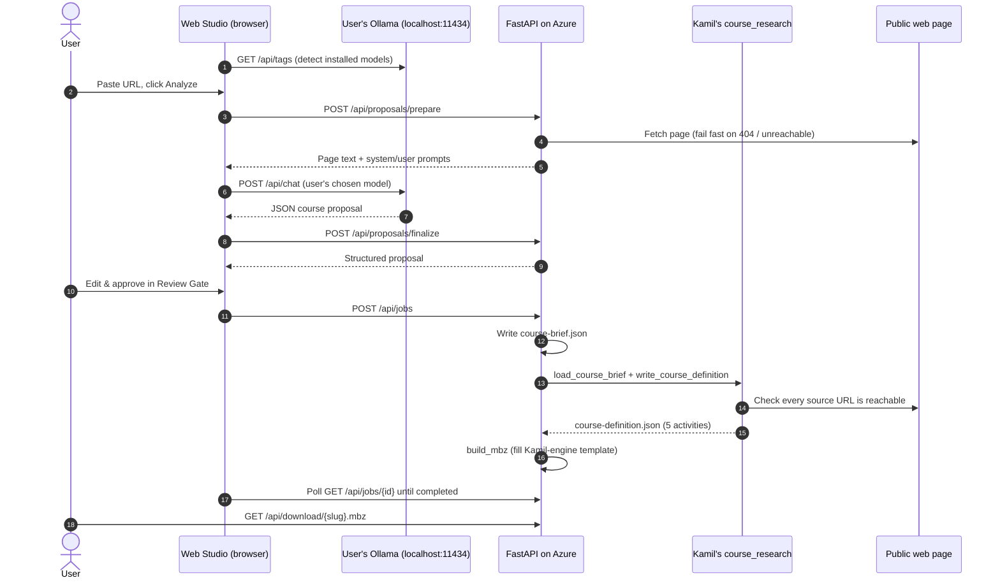

# FX Learning Studio (Moodle Studio): Architecture

FX Learning Studio turns a public learning URL (an article, documentation page, or
curriculum) into a native **Moodle 5.0.x course backup (`.mbz`)** that a Moodle
administrator restores as a new course.

It is built in two layers:

| Layer | Built by | What it is |
| :--- | :--- | :--- |
| **Course engine** | Kamil Janeczek (extended by Dinesh Panda) | Command-line tools that validate a Course Brief, build a Course Definition, and package it in a real Moodle. No AI inside. |
| **Web platform** | Abdus | A web app (FastAPI + Web Studio UI) that lets many users create courses from a browser, with AI running on each user's own laptop, deployed on Azure. |

Contents: [1. End-to-end workflow](#1-end-to-end-workflow) ·
[2. Why local models](#2-why-local-models) ·
[3. Kamil's course engine](#3-kamils-course-engine) ·
[4. Abdus's web platform](#4-abduss-web-platform) ·
[5. What is covered and what is not](#5-what-is-covered-and-what-is-not) ·
[6. Running it](#6-running-it) ·
[7. Deployment](#7-deployment-azure-container-apps) ·
[8. Reference](#8-reference)

---

## 1. End-to-end workflow

### 1.1 The picture

```text
 USER'S LAPTOP                                   AZURE (FastAPI container)
 ─────────────                                   ─────────────────────────
 Browser ── 1. paste URL ─────────────────────►  scrape page (reject broken links)
         ◄─ page text + AI prompt ────────────
    │
    ▼
 User's own Ollama (llama / gemma / qwen ...)
    2. AI writes the course proposal on the laptop
    │
 Browser ── 3. AI reply ──────────────────────►  parse into a proposal
         ◄─ proposal ─────────────────────────
    │
    ▼
 4. Review Gate: user edits & approves
    │
 Browser ── 5. Build ─────────────────────────►  a. write course-brief.json
                                                 b. course-definition.json  ← Kamil's course_research
                                                    (validates brief, checks every link is live)
                                                 c. course-package.mbz      ← template produced by
                                                                               Kamil's Moodle engine
         ◄─ 6. Download .mbz ─────────────────   stored in output/<course-slug>/
    │
    ▼
 7. Moodle: Site administration → Courses → Restore course
```

### 1.2 Sequence



### 1.3 Step by step

1. **Detect models.** On page load the browser calls the user's own Ollama at
   `http://localhost:11434` and lists the models installed on *that* laptop. The
   choice is stored per browser.
2. **Analyze.** The user pastes a URL (or a batch list, or uploads `.xlsx`/`.csv`).
   The server scrapes the page. If the page cannot be opened (for example HTTP 404)
   the request is rejected with *"Could not open: …"*; no course is invented from a
   URL that was never read.
3. **AI proposal.** The server returns the page text and the prompts. The browser
   runs them on the user's local model, then the server parses the reply into a
   proposal (course name, overview, duration, level, audience, module titles).
   If the reply is not valid JSON, a proposal is built from the page's headings.
4. **Review Gate.** The user edits any field and approves.
5. **Build** (a background job, tracked live in the Pipeline Tracker):
   - **a. Course Brief.** Written in the exact format Kamil's engine requires.
   - **b. Course Definition.** Kamil's `course_research` validates the brief and
     checks every source link is live. A broken link fails the job with a clear
     message, and the job's folder is removed.
   - **c. Course Package.** The `.mbz` is written from a five-activity template
     that Kamil's Moodle engine produced (see [4.4](#44-the-mbz-builder)).
6. **Download.** The tracker shows *Completed* with a download button; the course
   also appears in the Course Library.
7. **Import.** A Moodle administrator restores the `.mbz` into Moodle 5.0.x.

Every generated course has the same five activities (see
[docs/course-structure.md](docs/course-structure.md)):

| # | Activity | Moodle type |
| :--- | :--- | :--- |
| 1 | Course overview (outcome, module count, estimated time, instruction) | Page |
| 2 | Link to the entered URL (opens in a new window) | URL |
| 3 | Watch reference videos | Page |
| 4 | Submit Course Certification (upload certificate/badge/screenshot) | Assignment |
| 5 | Discussion Forum | Forum |

### 1.4 Cloud models instead of Ollama

A user without Ollama can connect their own Claude, ChatGPT, Gemini, or Grok key
in **Model Settings → Personal Cloud Accounts**. Step 3 then runs on the server with
that user's key (`POST /api/analyze-urls`); every other step is identical.

---

## 2. Why local models

The default AI is **Ollama running on each user's own laptop**, reached directly by
their browser.

| Reason | Detail |
| :--- | :--- |
| **No AI bill** | No per-token API charges and no paid subscriptions. |
| **No GPU on Azure** | Azure Container Apps runs CPU-only containers. Hosting an LLM for everyone would need a costly GPU service. |
| **Scales with users** | Each user brings their own compute, so 10 or 100 users do not slow each other down or add server load. |
| **Privacy of AI processing** | Prompts and model output stay on the user's laptop. (The page itself is fetched by the server.) |
| **User choice** | Each user picks any model they have installed (llama3.1, llama3.2, gemma3, qwen2.5 …), independently of other users. |

Trade-offs, and how they are handled:

- **Quality.** Small local models are weaker than frontier models; the Review Gate
  lets the user correct the proposal, and cloud models remain available.
- **Hardware.** A 7B–8B model needs roughly 5 GB of free RAM (16 GB laptops are
  fine; see [SETUP_GUIDE.md](SETUP_GUIDE.md) for recommended models).
- **One-time setup.** Ollama blocks websites it does not know. Each user runs
  `setx OLLAMA_ORIGINS "<deployed URL>"` (Windows) or the `launchctl` equivalent
  (Mac) once and restarts Ollama. The app detects this case and shows
  **"Ollama Blocked"** with the exact command.

The server never calls Ollama itself. An Azure container cannot see a user's
`localhost`, which is why an earlier version always reported "Ollama not
installed" on the deployed link.

---

## 3. Kamil's course engine

Kamil built the engine that defines what a course is and produces real Moodle
packages. Dinesh Panda later restored the fixed five-activity structure, automated
packaging, and spreadsheet input. **The engine contains no AI.** In its original
workflow an AI coding assistant (Codex or Claude Code) does the research and writes
the brief; the engine validates and packages.

| Part | Location | What it does |
| :--- | :--- | :--- |
| Brief loader & contract | `course_research/cli.py`, `course_research/domain.py` | Strict validation of the Course Brief: learning-time budget, unique sources, free-access evidence, en-US, entry level, activity-name length. |
| Source validation | `course_research/source_validation.py` | HTTP check that every source, the entered URL, and each reference video is reachable. |
| Definition generator | `course_research/generator.py` | Builds `course-definition.json`: identity, settings, and the five-activity structure. Refuses to overwrite. |
| Moodle scripts | `moodle-cli/*.php` | Inside a real Moodle: generate the course (`generate.php`), render activity HTML (`activity_content.php`), back up to `.mbz` (`backup.php`), restore and verify (`restore.php`, `verify.php`, learner checks). |
| CLI tools | `bin/course-definition`, `bin/course-package`, `bin/course-urls` | Bash entry points; `course-package` runs Moodle 5.0.3 + MariaDB via Docker Compose. |
| Moodle environment | `docker/moodle/`, `docker/mariadb-seed/`, `compose.yaml` | Disposable source and restore Moodle sites (ports 8080/8081); DB seed for fast builds. |
| Agent workflow | `.agents/skills/create-course/SKILL.md`, [docs/create-course.md](docs/create-course.md) | Instructions an AI coding agent follows: propose → research sources and videos → brief → definition → package. |

### 3.1 Kamil's original workflow (no web app)

```text
AI coding agent (Claude Code / Codex) following create-course skill
  1. Read URL, propose course → user confirms
  2. Research a source page per module + 1–3 YouTube videos
  3. Write output/<slug>/source-candidates-<date>.md and course-brief.json
        │
        ▼
bin/course-definition build      (course_research: validate + link checks)
        │
        ▼
bin/course-package build --accept --skip-restore --reuse
        (real Moodle in Docker: generate → learner check → backup → .mbz)
        │
        ▼
bin/course-package verify        (optional: restore into a clean Moodle)
```

How to run it locally is described in [6.2](#62-kamils-engine-on-its-own).

---

## 4. Abdus's web platform

Abdus built the self-service layer around the engine so that non-technical users can
create courses from a browser, and deployed it on Azure.

### 4.1 Components

| Component | File | Responsibility |
| :--- | :--- | :--- |
| Web Studio UI | `web_preview/index.html` | Create Course, Pipeline Tracker, Review Gate, Course Library, Model Settings. Contains the **browser-side Ollama client** (detect, test, pull, chat). |
| API | `backend/app/main.py` | REST endpoints, request tracing, per-user session middleware, static hosting of the UI. |
| Sessions | `backend/app/services/session_store.py` | One session per browser (cookie `fx_sid`): model choice and cloud keys are never shared between users. In memory, idle sessions expire after 24 h. |
| Scraper | `backend/app/services/scraper.py` | Fetches the page and extracts title, headings, body; reports fetch failures. |
| LLM client | `backend/app/services/llm_client.py` | Builds the proposal prompts and parses replies (shared by local and cloud paths); calls cloud providers. |
| Cloud accounts | `backend/app/services/auth_service.py` | Verifies a user's Claude/OpenAI/Gemini/Grok key with the provider. |
| Course builder | `backend/app/services/course_builder.py` | Background job: brief → Kamil's definition → `.mbz`. Reserves a unique folder per course. |
| `.mbz` builder | `backend/app/services/mbz_builder.py` + `backend/app/mbz_template/` | Writes the Moodle package without running Moodle. |
| Container & CI/CD | `Dockerfile`, `.github/workflows/deploy-containerapp.yml` | Single container serving UI + API on port 8080; deploys to Azure Container Apps on push to `main`. |

### 4.2 How the web platform uses Kamil's engine

| Engine part | Used by the web platform? |
| :--- | :--- |
| `course_research` (brief validation, link checks, definition) | **Yes, called directly** (`load_course_brief`, `write_course_definition`). Unmodified. |
| `moodle-cli` + `bin/course-package` (real Moodle) | **Not at runtime.** Azure Container Apps cannot run Docker. Its output is used as the `.mbz` template, and `bin/course-package verify` is the proof that web-built packages restore. |
| Agent research (per-module sources, videos) | **Not yet** (see [section 5](#5-what-is-covered-and-what-is-not)). |

No file in `course_research/`, `moodle-cli/`, `bin/`, or `docker/` is modified by the
web platform.

### 4.3 Multiple users

- **Model choice.** Each browser remembers its own model and talks to its own laptop's Ollama.
- **Server state.** Each browser has its own session for provider choice and cloud keys.
- **Course folders.** Each course gets its own folder: building the same course name twice creates `<slug>-2`, never overwriting.
- **Tested:** two concurrent users on llama3.2 and gemma3 each got their own model and their own course.

### 4.4 The `.mbz` builder

Every generated course has identical Moodle structure and internal IDs; only
course-specific text differs. The template is a real package produced by Kamil's
engine. `mbz_builder.py` replaces exactly these fields and leaves the rest
byte-for-byte unchanged:

- **Course:** full name, short name, summary, visibility.
- **Section:** name and introduction.
- **Overview page:** HTML.
- **Resources link:** name and URL.
- **Videos page:** HTML.
- **Backup header:** names, backup ID, date.
- **Timestamps,** plus the archive index sizes.

Activity HTML is rendered exactly as `moodle-cli/activity_content.php` does.

How it was verified:

1. **Round trip.** Two existing engine-built courses were rebuilt from their own
   `course-definition.json`. All 64 files matched the originals (apart from
   timestamps and backup ID).
2. **Restore proof.** A package built through the web app passed
   `bin/course-package verify`. It restored into a clean Moodle 5.0.3 and passed
   Kamil's structure, package, and learner-session checks.

> If the engine's course shape or activity HTML changes, regenerate
> `backend/app/mbz_template/five-activity-course.mbz` from a new engine-built
> package and re-run the round-trip check.

---

## 5. What is covered and what is not

| Capability | Status |
| :--- | :--- |
| Single URL, batch URL list, `.xlsx`/`.csv` upload | ✅ |
| Local Ollama per user, auto-detected; "Blocked" / "Not detected" guidance | ✅ |
| Personal cloud models (Claude, ChatGPT, Gemini, Grok) | ✅ |
| Independent users (per-browser model, per-session keys, unique course folders) | ✅ |
| Broken links rejected (at analyze time and by Kamil's validator) | ✅ |
| Review Gate editing | ✅ |
| Course Definition via Kamil's engine | ✅ |
| Real, restorable `.mbz` (5 activities) with live build tracking | ✅ |
| Course Library with download | ✅ |
| **Research a separate source page per module** | ❌ All modules point to the entered URL |
| **Reference videos** | ❌ Videos activity states that none were selected |
| Per-course trial restore inside the web app | ❌ Run `bin/course-package verify` before production import of important courses |

The two research gaps are what the AI agent does in Kamil's original workflow. Closing
them needs a search source the app can call (for example the YouTube Data API for
videos, or links on the entered page for sources); a local model cannot browse the
web by itself.

---

## 6. Running it

### 6.1 Web platform on a laptop

Requirements: Python 3.11+, Ollama with at least one model (`ollama run llama3.2`).

- **Windows:** double-click `start.bat`
- **Mac/Linux:** run `./start.sh`

Each script installs dependencies if needed and opens `http://localhost:8088/`.
Ollama allows `localhost` by default, so `OLLAMA_ORIGINS` is only needed for the
deployed link. Packaging needs no Docker.

### 6.2 Kamil's engine on its own

Requirements: Python 3.11+, Docker Desktop running, Git Bash (the `bin/` tools are
bash), ports 8080/8081 free.

- **With an AI agent (as in the KT session).** Start Claude Code or Codex in the
  repository root and have it follow `.agents/skills/create-course/SKILL.md` with a
  URL, or `build from input` for the spreadsheet in `input/`. Codex discovers it as
  `$create-course`. For Claude Code, copy it to `.claude/skills/create-course/` to
  use `/create-course`.
- **By hand.** Write `output/<slug>/course-brief.json` using
  `examples/copilot-studio-course-brief.json`, then:

  ```bash
  bin/course-definition build --brief output/<slug>/course-brief.json \
    --output output/<slug>/course-definition.json
  bin/course-package build --definition output/<slug>/course-definition.json \
    --output output/<slug>/course-package.mbz --accept --skip-restore --reuse
  bin/course-package verify --package output/<slug>/course-package.mbz \
    --definition output/<slug>/course-definition.json      # optional restore proof
  bin/course-package down                                     # remove disposable Moodle
  ```

---

## 7. Deployment (Azure Container Apps)

- **App:** `fx-moodle-studio` in `karthik-playground-rg` (Sweden Central), external
  HTTPS ingress, container port 8080.
- **Image:** `Dockerfile`, built from `python:3.11-slim`. It contains the UI, API,
  `course_research`, and the `.mbz` template. There is no Moodle or Docker inside.
- **CI/CD:** `.github/workflows/deploy-containerapp.yml` builds and deploys on push
  to `main` or `master`.
- **Environment:**

  | Variable | Value |
  | :--- | :--- |
  | `PORT` | `8080` |
  | `LOG_LEVEL` | `INFO` |
  | `LLM_PROVIDER` | `local` (default for new sessions) |

**Before scaling up:**

| Concern | Detail | Action |
| :--- | :--- | :--- |
| Courses are lost on restart or redeploy | The container's `output/` folder is temporary | Mount an Azure Files share at `/app/output` |
| Settings and build progress can disappear | Sessions and build jobs are kept in memory, per instance | Run a single instance, or enable sticky sessions |
| One-time user setup | Each user must allow the deployed URL in Ollama | Point users to the `OLLAMA_ORIGINS` step in [SETUP_GUIDE.md](SETUP_GUIDE.md) |

---

## 8. Reference

### 8.1 API endpoints

```http
# Health
GET  /health
GET  /health/liveness
GET  /health/readiness              # storage mounted

# Status & logs
GET  /api/system-status             # provider + selected model (local models are probed by the browser)
GET  /api/logs                      # recent server logs

# Local-model flow (AI runs in the user's browser → their Ollama)
POST /api/proposals/prepare         # scrape URLs, return page text + prompts
POST /api/proposals/finalize        # parse a model reply into a proposal
POST /api/extract-urls              # URLs from an uploaded .xlsx/.csv

# Cloud-model flow (AI runs on the server with the user's key)
POST /api/analyze-urls
POST /api/upload-spreadsheet

# Model settings (per user session)
GET  /api/llm/config
POST /api/llm/config
POST /api/llm/test                  # cloud only
GET  /api/llm/test-stream           # cloud only (SSE)

# Cloud accounts (per user session)
GET  /api/auth/providers
POST /api/auth/connect/{provider_id}
POST /api/auth/disconnect/{provider_id}
GET  /api/auth/status
POST /api/auth/logout

# Build & library
POST /api/jobs                      # build one approved proposal
POST /api/jobs/batch                # build several
GET  /api/jobs/{job_id}             # status, progress, logs
GET  /api/courses                   # Course Library
GET  /api/download/{slug}.mbz
```

Job steps reported by `GET /api/jobs/{job_id}`:
`scrapingUrl` → `synthesizingAi` → `compilingDefinition` → `packagingMbz` →
`completed` (or `failed`, with the reason in `error`).

### 8.2 Output layout

```text
output/<course-slug>/
├── course-brief.json        # written by the web app (or the AI agent)
├── course-definition.json   # written by Kamil's course_research
└── course-package.mbz       # Moodle 5.0.x backup
```

Courses created with Kamil's agent workflow also contain
`source-candidates-<date>.md` (the research dossier) and may have versioned files
(`-v2`, `-v3`).
