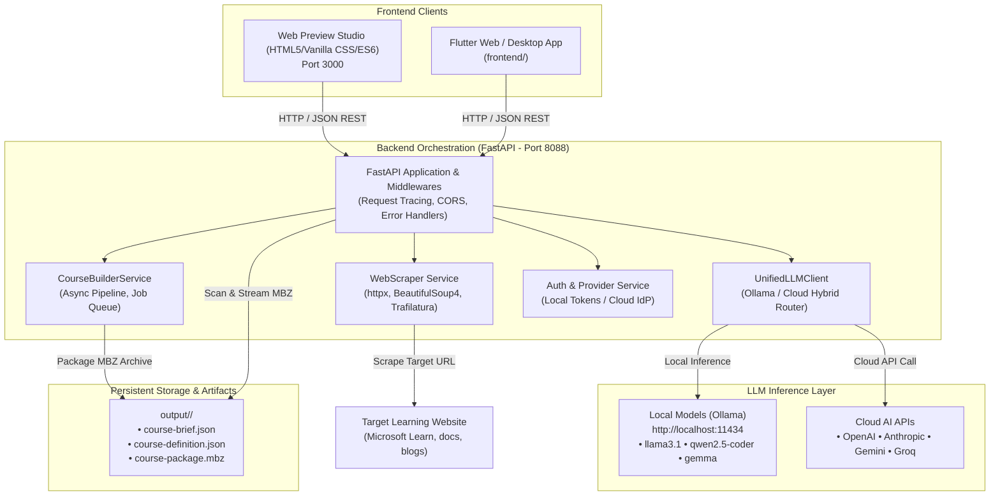

# LMS01 FX Learning Agent - System Architecture & Operations Manual

> Note: The primary architecture specification is maintained in [ARCHITECTURE.md](file:///c:/LMS01-fx-learning-agent/ARCHITECTURE.md).

## 1. Executive Overview

The **FX Learning Agent (FusionAIx Moodle Studio)** is an enterprise AI-powered course generation platform that transforms raw web documentation, technical articles, and curriculum URLs into production-ready, native Moodle 5.x course backup archives (`.mbz`).

The platform incorporates:
- An **Interactive Human Review Gate** where instructional designers inspect and fine-tune AI-derived course metadata before packaging.
- A **Dual-Pane Live Preview Canvas** that simulates the student learner experience in Moodle 5.x in real time.
- A **Hybrid LLM Execution Engine** supporting local open-source models via Ollama (zero-cost, private, offline) as well as personal cloud LLMs (Claude, OpenAI, Gemini, Groq).

---

## 2. High-Level Architecture Diagram



---

## 3. Frontend Architecture

### 3.1 Technology Stack
- **Framework**: Semantic HTML5, Modular CSS Design System, Vanilla ES6 JavaScript.
- **Design Tokens**: FusionAIx Obsidian & Slate Dark Theme (`--bg-black: #000000`, `--card-bg: #111111`, `--border: #262626`, `--accent-green: #05A357`, `--accent-blue: #276EF1`).
- **Typography**: Google Fonts (*Plus Jakarta Sans* & *JetBrains Mono*).

### 3.2 Navigation & Layout Hierarchy
1. **Centered Header Navigation**:
   - **Left Wing**: Brand badge (`fusionAIx` logo + `Moodle Studio` pill).
   - **Center Segmented Control**: 4 tabs centered using balanced flex wings:
     - `Create Course` (`#view-input`)
     - `Review Gate` (`#view-review`)
     - `Build Tracker` (`#view-progress`)
     - `Course Library` (`#view-library`)
   - **Right Wing**: Live AI Model Switcher button with real-time status beacon.

2. **Core Views**:
   - **Create Course Tab**: URL input, batch URLs input, Excel/CSV spreadsheet upload, provider settings.
   - **Review Gate Tab (Dual-Pane Layout)**:
     - **Left Pane (Blueprint Editor)**: Compact, high-density form fields for Course Title, Overview, Duration, Learner Level (Beginner / Intermediate / Advanced), Target Audience, and Curriculum Module chips.
     - **Right Pane (Live Moodle 5.x Canvas)**: Simulated LMS student course player with window chrome (`🔴 🟡 🟢`), breadcrumbs, pulsing `LIVE SYNC` indicator, Course Hero banner, and Moodle activity cards (Page 📄, Resource 🌐, Book 📘, Assignment ✍️, Forum 💬).
   - **Build Tracker Tab**: Dynamic 5-stage progress meter and real-time telemetry console.
   - **Course Library Tab**: Real-time disk inventory scanning `output/`, client-side multi-facet search/filtering, and direct `.mbz` download links.

---

## 4. Backend Architecture

### 4.1 Technology Stack
- **Runtime**: Python 3.10+
- **Web Framework**: FastAPI & Starlette
- **ASGI Server**: Uvicorn
- **HTTP Client**: HTTPX (async)
- **HTML Parsing**: BeautifulSoup4, Trafilatura
- **Data Validation**: Pydantic v2 schemas

### 4.2 Core Service Components

| Service | File Location | Responsibility |
| :--- | :--- | :--- |
| **FastAPI Core** | `backend/app/main.py` | API endpoints, CORS, request tracing middleware with UUIDs, health probes. |
| **WebScraper** | `backend/app/services/scraper.py` | Extracts syllabus, headings, duration, and text from public course URLs with resilient fallbacks. |
| **UnifiedLLMClient** | `backend/app/services/llm_client.py` | Hybrid client routing between local Ollama (`http://localhost:11434`) and Cloud APIs. |
| **CourseBuilderService**| `backend/app/services/course_builder.py` | Asynchronous job runner creating course briefs, definitions, and native `.mbz` bundles. |
| **AuthService** | `backend/app/services/auth_service.py` | Manages connection status for OpenAI, Claude, Gemini, and Groq personal accounts. |

### 4.3 REST API Endpoints Reference

```http
# Health & Monitoring Probes
GET  /health                      # Basic service health
GET  /health/readiness            # K8s readiness probe (checks LLM and storage)
GET  /health/liveness             # K8s liveness probe

# Course Analysis & Proposals
POST /api/analyze-urls            # Scrapes URL and returns AI course proposal
POST /api/upload-spreadsheet      # Extracts URLs from .xlsx/.csv and analyzes

# Generation Pipeline Jobs
POST /api/jobs                    # Trigger background .mbz build job
GET  /api/jobs/{job_id}           # Poll job status, progress, and logs
POST /api/jobs/batch              # Trigger batch build for multiple proposals

# Course Package Library & Downloads
GET  /api/courses                 # List all completed packages from output/
GET  /api/download/{slug}.mbz     # Stream binary Moodle .mbz archive

# Engine & Model Configuration
GET  /api/config/llm              # Get active LLM provider, model, and Ollama tags
POST /api/config/llm              # Update active LLM model or provider at runtime
POST /api/test/llm                # Test connectivity to active LLM
```

---

## 5. How to Access and Run the System

### 5.1 Prerequisites
- Python 3.10+ installed
- Node.js or Python `http.server` for serving the web preview
- Git

### 5.2 Step 1: Install Backend Dependencies
Open your terminal in the repository root:
```bash
# Navigate to backend directory
cd backend

# Create and activate a virtual environment (optional but recommended)
python -m venv venv
# Windows:
venv\Scripts\activate
# Linux/macOS:
# source venv/bin/activate

# Install required packages
pip install -r requirements.txt
```

### 5.3 Step 2: Start the FastAPI Backend
```bash
# Start backend on port 8088
python -m uvicorn app.main:app --host 0.0.0.0 --port 8088 --reload
```
- **Backend API**: `http://localhost:8088`
- **Interactive Swagger Docs**: `http://localhost:8088/docs`
- **Health Check**: `http://localhost:8088/health`

### 5.4 Step 3: Start the Web Preview UI
In a separate terminal:
```bash
# Serve the web_preview directory on port 3000
python -m http.server 3000 --directory web_preview
```
- **Web UI URL**: `http://localhost:3000`

---

## 6. How to Install and Configure Local Models (Ollama)

The system default is configured to use **local open-source models** through **Ollama**. Local execution provides:
- **100% Data Privacy**: No curriculum content or prompts leave your machine.
- **Zero Cloud Cost**: Completely free and offline-capable.
- **Fast Local Latency**: Ideal for workstations with GPUs or unified memory (Apple Silicon / NVIDIA RTX).

### 6.1 Step 1: Install Ollama
Download and install Ollama for your operating system:
- **Windows**: Download the installer from [ollama.com/download/windows](https://ollama.com/download/windows) and run setup.
- **macOS**: Download from [ollama.com/download/mac](https://ollama.com/download/mac) or install via Homebrew:
  ```bash
  brew install ollama
  ```
- **Linux**:
  ```bash
  curl -fsSL https://ollama.com/install.sh | sh
  ```

### 6.2 Step 2: Download and Run Recommended Models
Open PowerShell, Command Prompt, or Terminal, and run one or more of the following:

#### Recommended General Model (Balanced Speed & Quality)
```bash
ollama run llama3.1:latest
```

#### Lightweight Model (Ideal for laptops with 8GB RAM)
```bash
ollama run llama3.2:latest
```

#### High-Precision Coding & Technical Model
```bash
ollama run qwen2.5-coder:14b
```

#### Google Open Weights Model
```bash
ollama run gemma2:9b
```

### 6.3 Step 3: Verify Ollama is Running
Check that the local Ollama server is responding:
```bash
curl http://localhost:11434/api/tags
```
You will receive a JSON list of installed local models.

### 6.4 Step 4: Configure Backend Environment Variables
Create or update your `.env` file in `backend/.env`:
```env
# LLM Provider Configuration
LLM_PROVIDER=local
LLM_LOCAL_BASE_URL=http://localhost:11434
LLM_MODEL=llama3.1:latest
LLM_TIMEOUT=60.0

# Server Configuration
PORT=8088
LOG_LEVEL=INFO
```

### 6.5 Step 5: Switch Models Live from the UI
You can switch active models without restarting the server:
1. Open the UI at `http://localhost:3000`.
2. Click the model pill in the top-right corner of the navigation bar (e.g., `llama3.1:latest ▾`).
3. Select any installed local model detected from your Ollama instance.
4. Click **Apply Settings**. The backend immediately routes new course extraction requests through that model.

---

## 7. Storage & Output Directory Structure

Generated course artifacts are persisted in the `output/` directory in accordance with repository standards:

```
output/
├── <course-slug-1>/
│   ├── course-brief.json          # High-level curriculum syllabus & metadata
│   ├── course-definition.json     # Full Moodle activity specification
│   └── course-package.mbz         # Native, restorable Moodle 5.x backup archive
└── <course-slug-2>/
    ├── course-brief.json
    ├── course-definition.json
    └── course-package.mbz
```

Each course package can be restored directly into any standard Moodle 4.x / 5.x instance via **Course Administration > Restore**.
