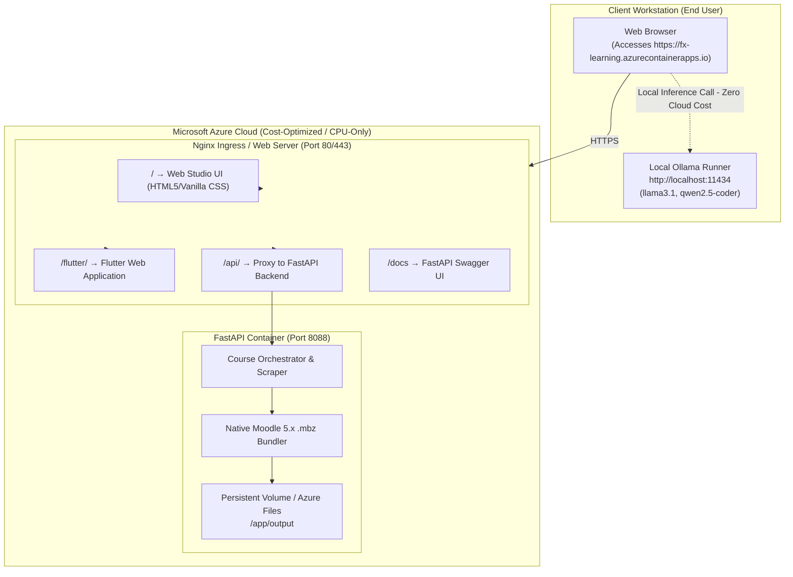

# Azure Deployment Plan: FX Learning Agent

> Note: The interactive artifact is available at [azure_deployment_plan.md](file:///C:/Users/abduss/.gemini/antigravity-ide/brain/52ecd1e1-a625-45df-82c3-61fac4ffb955/azure_deployment_plan.md).

## 1. Executive Strategy & Cost Optimization

### Key Requirements
1. **Cloud Target**: Microsoft Azure.
2. **AI Inference Strategy**: **Zero Cloud GPU Costs**. End-users download and run open-source models (Ollama) directly on their local machines, or use their personal cloud API keys. The Azure host does **not** need expensive GPU compute.
3. **Dual Frontend**: Host both the **Web Studio** (`web_preview/`) and the **Flutter Web Application** (`frontend/`) behind a unified Nginx reverse proxy routing to the FastAPI backend.

### Cost Profile
| Component | Azure Service | Estimated Monthly Cost |
| :--- | :--- | :--- |
| **API & App Hosting** | Azure Container Apps (Consumption Tier) or Azure App Service (B1 Basic) | **$0 – $13 / month** (Free tier covers initial requests) |
| **GPU / AI Compute** | **$0** (Offloaded to users' local machines via Ollama or personal keys) | **$0.00** |
| **Container Registry** | Azure Container Registry (Basic) | **~$5 / month** |
| **Total** | | **~$5 – $18 / month** |

---

## 2. Target Architecture Diagram



---

## 3. How Client-Side Local Models Work in Cloud Deployment

Because the backend is hosted on Azure while Ollama runs on the end-user's local machine, **the user's browser acts as the direct bridge**:

1. **Browser-to-Local Inference**:
   The user's browser on `localhost` communicates directly with their local Ollama instance (`http://localhost:11434/api/generate` or `/api/tags`).
2. **CORS on Local Ollama**:
   To allow the Azure web app to call the user's local Ollama from the browser, the user simply runs Ollama with CORS enabled:
   - **Windows**: In system environment variables, set `OLLAMA_ORIGINS=*`
   - **macOS/Linux**: `OLLAMA_ORIGINS="*" ollama serve`
3. **Payload Forwarding**:
   The browser receives the extracted course syllabus from local Ollama and submits the structured proposal to the Azure backend (`POST /api/jobs`) to package and download the native `.mbz` file.
4. **Personal Cloud Keys (Alternative)**:
   Users who don't have local Ollama can input their personal Claude/OpenAI/Gemini key in the Model Switcher modal. Keys are saved in their browser `localStorage` and never shared across users.

---

## 4. Unified Containerization Strategy

We will combine the FastAPI backend, the Web Studio UI, and the compiled Flutter Web application into a single container orchestrated by Nginx, or deploy as a multi-container Azure Container App.

### Option A: Unified All-in-One Container (Recommended for Azure App Service & Single Container Apps)

#### Nginx Routing Configuration (`deploy/nginx.conf`)
```nginx
server {
    listen 80;
    server_name localhost;
    client_max_body_size 50M;

    # 1. Web Studio UI (Default Landing)
    location / {
        root /usr/share/nginx/html/web_preview;
        index index.html;
        try_files $uri $uri/ /index.html;
    }

    # 2. Flutter Web Application
    location /flutter/ {
        alias /usr/share/nginx/html/flutter/;
        index index.html;
        try_files $uri $uri/ /flutter/index.html;
    }

    # 3. FastAPI REST Backend Proxy
    location /api/ {
        proxy_pass http://127.0.0.1:8088/api/;
        proxy_set_header Host $host;
        proxy_set_header X-Real-IP $remote_addr;
        proxy_set_header X-Forwarded-For $proxy_add_x_forwarded_for;
        proxy_set_header X-Forwarded-Proto $scheme;
    }

    # 4. OpenAPI / Swagger Documentation
    location /docs {
        proxy_pass http://127.0.0.1:8088/docs;
        proxy_set_header Host $host;
    }

    location /openapi.json {
        proxy_pass http://127.0.0.1:8088/openapi.json;
        proxy_set_header Host $host;
    }

    location /health {
        proxy_pass http://127.0.0.1:8088/health;
    }
}
```

#### Production Dockerfile (`deploy/Dockerfile`)
```dockerfile
# ==========================================
# Stage 1: Build Flutter Web Client
# ==========================================
FROM ghcr.io/cirruslabs/flutter:stable AS flutter-builder
WORKDIR /app/flutter
COPY frontend/pubspec.yaml .
RUN flutter pub get
COPY frontend/ .
RUN flutter build web --release

# ==========================================
# Stage 2: Final Production Runtime Container
# ==========================================
FROM python:3.11-slim

WORKDIR /app

# Install system dependencies & Nginx
RUN apt-get update && apt-get install -y --no-install-recommends \
    nginx \
    curl \
    supervisor \
    && rm -rf /var/lib/apt/lists/*

# Install Python backend dependencies
COPY backend/requirements.txt /app/backend/
RUN pip install --no-cache-dir -r /app/backend/requirements.txt

# Copy Backend Source Code
COPY backend /app/backend

# Copy Web Studio HTML/CSS
COPY web_preview /usr/share/nginx/html/web_preview

# Copy Built Flutter Web App from Stage 1
COPY --from=flutter-builder /app/flutter/build/web /usr/share/nginx/html/flutter

# Copy Nginx & Supervisor Configs
COPY deploy/nginx.conf /etc/nginx/conf.d/default.conf
COPY deploy/supervisord.conf /etc/supervisor/conf.d/supervisord.conf

# Output directory for course artifacts
RUN mkdir -p /app/output

EXPOSE 80

CMD ["/usr/bin/supervisord", "-c", "/etc/supervisor/conf.d/supervisord.conf"]
```

#### Supervisor Configuration (`deploy/supervisord.conf`)
```ini
[supervisord]
nodaemon=true
logfile=/var/log/supervisord.log
pidfile=/var/run/supervisord.pid

[program:fastapi]
command=python -m uvicorn app.main:app --host 127.0.0.1 --port 8088
directory=/app/backend
autostart=true
autorestart=true
stdout_logfile=/dev/stdout
stdout_logfile_maxbytes=0
stderr_logfile=/dev/stderr
stderr_logfile_maxbytes=0

[program:nginx]
command=/usr/sbin/nginx -g "daemon off;"
autostart=true
autorestart=true
stdout_logfile=/dev/stdout
stdout_logfile_maxbytes=0
stderr_logfile=/dev/stderr
stderr_logfile_maxbytes=0
```

---

## 5. Step-by-Step Azure Deployment Guide

### Prerequisites
- [Azure CLI](https://learn.microsoft.com/en-us/cli/azure/install-azure-cli) installed (`az version`)
- Docker installed locally
- Active Azure subscription

### Phase 1: Login & Resource Group Setup
```bash
# 1. Log in to Azure
az login

# 2. Set your default subscription (if multiple)
az account set --subscription "<YOUR_SUBSCRIPTION_NAME_OR_ID>"

# 3. Create a Resource Group
az group create --name rg-fx-learning-prod --location eastus
```

### Phase 2: Create Azure Container Registry (ACR)
```bash
# 1. Create a private ACR instance
az acr create --resource-group rg-fx-learning-prod --name acrfxlearning --sku Basic --admin-enabled true

# 2. Log in to ACR
az acr login --name acrfxlearning

# 3. Build & push production image to ACR
az acr build --registry acrfxlearning --image fx-learning-studio:latest -f deploy/Dockerfile .
```

### Phase 3: Deploy to Azure Container Apps (Serverless & Free Tier Friendly)
```bash
# 1. Create Container Apps Environment
az containerapp env create \
  --name env-fx-learning \
  --resource-group rg-fx-learning-prod \
  --location eastus

# 2. Get ACR Credentials
ACR_USERNAME=$(az acr credential show --name acrfxlearning --query username -o tsv)
ACR_PASSWORD=$(az acr credential show --name acrfxlearning --query "passwords[0].value" -o tsv)

# 3. Deploy the Container App
az containerapp create \
  --name app-fx-learning \
  --resource-group rg-fx-learning-prod \
  --environment env-fx-learning \
  --image acrfxlearning.azurecr.io/fx-learning-studio:latest \
  --target-port 80 \
  --ingress external \
  --registry-server acrfxlearning.azurecr.io \
  --registry-username $ACR_USERNAME \
  --registry-password $ACR_PASSWORD \
  --cpu 1.0 \
  --memory 2.0Gi \
  --min-replicas 1 \
  --max-replicas 3
```

---

## 6. Accessing Your Deployed Application

Once the deployment completes, Azure will output your public FQDN URL (e.g. `https://app-fx-learning.eastus.azurecontainerapps.io`):

| Interface | URL Path | Description |
| :--- | :--- | :--- |
| **Web Studio** | `https://<YOUR_APP_URL>/` | Primary responsive Web Studio UI with live Review Gate. |
| **Flutter Web App** | `https://<YOUR_APP_URL>/flutter/` | Flutter web client with full course library. |
| **REST API Docs** | `https://<YOUR_APP_URL>/docs` | Interactive Swagger OpenAPI documentation. |
| **Health Probe** | `https://<YOUR_APP_URL>/health` | Service uptime and readiness verification. |

---

## 7. How End Users Connect Their Local Models

When an end user visits your deployed Azure link:
1. They install [Ollama](https://ollama.com) on their computer.
2. In terminal, they run:
   ```bash
   ollama run llama3.1:latest
   ```
3. To permit cross-origin requests from your Azure domain:
   - **Windows**: Add System Variable `OLLAMA_ORIGINS=*` and restart Ollama.
   - **macOS/Linux**: `OLLAMA_ORIGINS="*" ollama serve`
4. In the Azure Web App, they open the **Model Switcher** (`⚙️`) in the top navigation bar.
5. The app detects their local Ollama instance at `http://localhost:11434`, runs the course analysis on their local hardware for free, and generates the Moodle `.mbz` package without using any Azure GPU compute.

---

## 8. Verification & Rollback Procedures

```bash
# View live streaming logs from Azure
az containerapp logs show --name app-fx-learning --resource-group rg-fx-learning-prod --follow

# Restart the application
az containerapp revision restart --name app-fx-learning --resource-group rg-fx-learning-prod

# Update application image after future git changes
az acr build --registry acrfxlearning --image fx-learning-studio:v2 -f deploy/Dockerfile .
az containerapp update --name app-fx-learning --resource-group rg-fx-learning-prod --image acrfxlearning.azurecr.io/fx-learning-studio:v2
```
