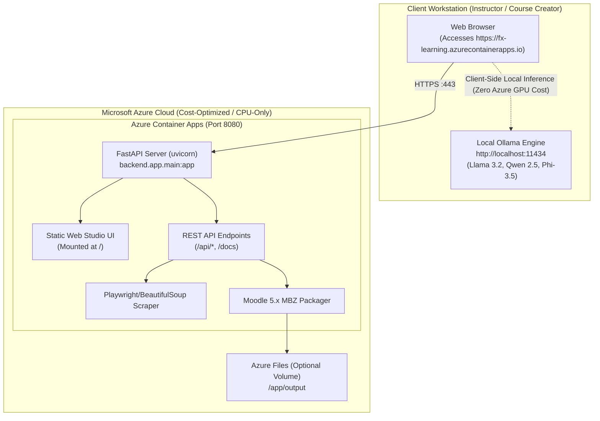

# LMS01 FX Learning Agent - Master Deployment Plan

## 1. Overview & Architecture Strategy

This deployment plan provides two deployment pathways for the FX Learning Agent:

1. **Path A: Local Windows Distribution (Zero-Install / 1-Click)**
   - **Target Audience**: Internal instructional designers, course creators, and local Windows users.
   - **Cost**: **$0.00**.
   - **Runtime Requirements**: Python 3.11+ and Ollama (or personal cloud API keys).
   - **Docker / PHP Dependency**: **None**. Runs 100% native on Windows via [`start.bat`](file:///Users/abdussamad/LMS01-fx-learning-agent/start.bat).

2. **Path B: Cloud Deployment on Microsoft Azure (Single Monolithic Container)**
   - **Target Audience**: Team access via private URL, remote instructors, cross-platform users.
   - **Cost**: **~$5 – $15 / month** (Azure Container Apps Consumption tier + Azure Container Registry).
   - **Cloud GPU Cost**: **$0.00**. Uses zero cloud GPUs by utilizing local client-side inference or free/personal API keys.
   - **Docker / PHP Dependency**: The cloud host runs the monolithic [`Dockerfile`](file:///Users/abdussamad/LMS01-fx-learning-agent/Dockerfile) (Python 3.11-slim). Zero Docker-in-Docker and zero PHP.

---

## 2. Path A: Local Windows Deployment (Recommended for Local Use)

### Prerequisites
- Windows 10 or Windows 11 (64-bit)
- Python 3.11 or newer (installed with "Add Python to PATH" checked)
- [Ollama for Windows](https://ollama.com/download/windows) (Optional if using Gemini/OpenAI/Claude API keys)

### Distribution Package Structure
To distribute locally to instructors or team members, provide the workspace folder containing:
```text
LMS01-fx-learning-agent/
├── start.bat                  <-- 1-Click Launcher (double-click to run)
├── backend/                   <-- FastAPI orchestration engine & find_port utility
├── course_research/           <-- Research & syllabus generation modules
├── web_preview/               <-- Modern corporate Web Studio UI (HTML/CSS/JS)
├── output/                    <-- Local storage for generated .mbz packages
└── requirements.txt (in backend/)
```

### End-User Workflow (Zero Command Line Needed)
1. **Launch**: Double-click [`start.bat`](file:///Users/abdussamad/LMS01-fx-learning-agent/start.bat).
2. **Automatic Initialization**:
   - The launcher detects Python (`python`, `py -3`, or `py`).
   - Checks if virtual environment `.venv` exists; if not, creates it and installs dependencies automatically.
   - Scans for an open port starting at `8088` up to `8108` via [`backend/app/find_port.py`](file:///Users/abdussamad/LMS01-fx-learning-agent/backend/app/find_port.py) to prevent port conflicts.
   - Opens the default browser to `http://localhost:<PORT>/`.
3. **1-Click AI Model Setup**:
   - The user clicks **1-Click Download** for their preferred model (`Llama 3.2` or `Llama 3.1`) right in the browser.
   - The backend pulls the model and shows a real-time progress bar.
4. **Generate Courses**:
   - Paste a source URL (documentation, tutorial, or syllabus).
   - Click **Generate Full Course Proposal** -> Review syllabus -> Download native `.mbz` file.

---

## 3. Path B: Microsoft Azure Cloud Deployment

### Architectural Topology


### Step-by-Step Azure Deployment Guide

#### Step 1: Azure CLI Authentication & Resource Group Setup
```bash
# 1. Log in to Azure account
az login

# 2. Select subscription (if multiple subscriptions exist)
az account set --subscription "<YOUR_SUBSCRIPTION_ID>"

# 3. Create a dedicated Resource Group (e.g., East US)
az group create --name rg-fx-learning-prod --location eastus
```

#### Step 2: Create Azure Container Registry (ACR) & Build Image
Azure Container Registry builds the container in the cloud without needing Docker installed locally:
```bash
# 1. Create a Basic tier container registry (cost: ~$5/month)
az acr create \
  --resource-group rg-fx-learning-prod \
  --name acrfxlearning$RANDOM \
  --sku Basic \
  --admin-enabled true

# Note the registry name created above (e.g., acrfxlearning12345)
export ACR_NAME="<YOUR_ACR_NAME>"

# 2. Build the monolithic container directly in ACR using cloud build
az acr build \
  --registry $ACR_NAME \
  --image fx-learning-studio:v1 \
  --file Dockerfile .
```

#### Step 3: Deploy to Azure Container Apps (Serverless Consumption Tier)
```bash
# 1. Create the Container Apps Managed Environment
az containerapp env create \
  --name env-fx-learning \
  --resource-group rg-fx-learning-prod \
  --location eastus

# 2. Retrieve ACR Admin Credentials
ACR_USERNAME=$(az acr credential show --name $ACR_NAME --query username -o tsv)
ACR_PASSWORD=$(az acr credential show --name $ACR_NAME --query "passwords[0].value" -o tsv)

# 3. Deploy the Container App
az containerapp create \
  --name app-fx-learning \
  --resource-group rg-fx-learning-prod \
  --environment env-fx-learning \
  --image ${ACR_NAME}.azurecr.io/fx-learning-studio:v1 \
  --target-port 8080 \
  --ingress external \
  --registry-server ${ACR_NAME}.azurecr.io \
  --registry-username $ACR_USERNAME \
  --registry-password $ACR_PASSWORD \
  --cpu 1.0 \
  --memory 2.0Gi \
  --min-replicas 1 \
  --max-replicas 3 \
  --env-vars \
    LOG_LEVEL=INFO \
    PORT=8080
```

#### Step 4: Obtain Public Application URL
```bash
az containerapp show \
  --name app-fx-learning \
  --resource-group rg-fx-learning-prod \
  --query properties.configuration.ingress.fqdn \
  -o tsv
```
This returns your live HTTPS URL (e.g., `https://app-fx-learning.eastus.azurecontainerapps.io`).

---

## 4. How Local Models (Ollama) Work With Cloud Deployment

When the application is deployed in Azure, you have two options for AI generation:

### Option 1: Browser-to-Local Ollama (Zero Cost, 100% Private)
The Azure container does **not** run LLM models on expensive cloud GPUs. Instead:
1. The user opens the Azure URL (`https://app-fx-learning.azurecontainerapps.io`).
2. The user has Ollama running on their local computer (`http://localhost:11434`).
3. To allow the Azure web app to communicate with their local Ollama, the user enables CORS in Ollama:
   - **Windows**: Add System Environment Variable `OLLAMA_ORIGINS=*` (or `https://*.azurecontainerapps.io`) and restart Ollama.
   - **macOS / Linux**: Run `OLLAMA_ORIGINS="*" ollama serve`.
4. In the Web Studio, the **Model Switcher** detects their local models and performs inference in their browser.

### Option 2: Cloud API Keys (Gemini, Claude, OpenAI, Groq)
If the user does not want to install Ollama locally:
1. In the Web Studio header, click the **Model Settings** button.
2. Select **Cloud API** tab.
3. Paste a free Google Gemini API key or Groq API key.
4. Keys are stored locally in the user's browser `localStorage` and sent with their requests.

---

## 5. Model Selection Guide for 16 GB RAM Systems

For users running local models on 16 GB RAM machines, here are the optimal models that run fast without consuming all system memory:

| Model | Size | RAM Used | Speed (16 GB RAM) | Best For |
| :--- | :--- | :--- | :--- | :--- |
| **Llama 3.2 (3B)** | **2.0 GB** | ~3.2 GB | **Very Fast (~35-50 tok/s)** | Fast drafts, low-resource laptops, high responsiveness. |
| **Qwen 2.5 (3B / 7B)** | **2.0 GB / 4.7 GB** | ~3.5 GB / ~6.0 GB | **Fast (~25-40 tok/s)** | Structured JSON, technical syllabi, curriculum hierarchy. |
| **Phi-3.5 Mini (3.8B)** | **2.2 GB** | ~3.6 GB | **Fast (~30 tok/s)** | High logical reasoning, concise learning objectives. |
| **Llama 3.1 (8B)** | **4.7 GB** | ~6.5 GB | **Balanced (~18-25 tok/s)** | Rich pedagogic explanations, comprehensive quizzes. |
| **Gemma 2 (2B / 9B)** | **1.6 GB / 5.4 GB** | ~2.8 GB / ~7.2 GB | **Very Fast (~30-45 tok/s)** | Lightweight Google architecture, clean summaries. |

---

## 6. Verification & Operational Runbook

### Health Check Endpoints
Verify all deployed endpoints:
```bash
# 1. Health Probe
curl -I https://<YOUR_APP_URL>/api/system-status

# 2. Swagger OpenAPI Documentation
https://<YOUR_APP_URL>/docs

# 3. Web Studio Interface
https://<YOUR_APP_URL>/
```

### Viewing Cloud Logs
```bash
az containerapp logs show \
  --name app-fx-learning \
  --resource-group rg-fx-learning-prod \
  --follow
```

### Rolling Out Updates
When code updates are pushed:
```bash
# 1. Build new image version
az acr build --registry $ACR_NAME --image fx-learning-studio:v2 --file Dockerfile .

# 2. Update Azure Container App revision
az containerapp update \
  --name app-fx-learning \
  --resource-group rg-fx-learning-prod \
  --image ${ACR_NAME}.azurecr.io/fx-learning-studio:v2
```
