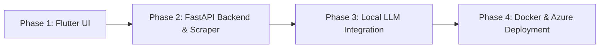

# Product Requirements Document (PRD)

## Project: FX Learning Course Generator - Standalone Application (Flutter UI + Local LLM + Azure Deployment)

- **Version**: 1.0.0
- **Status**: Draft / Approved for Implementation
- **Target Audience**: Non-technical corporate learners, training managers, HR teams, LMS administrators.

---

## 1. Executive Summary & Problem Statement

### 1.1 Background
The current `fx-learning-agent` repository is an internal developer toolkit built around command-line scripts and coding-agent skills. While functionally powerful, it requires:
1. Command-line familiarity (Docker, Bash, Python scripts).
2. An IDE-hosted coding assistant (Codex / Antigravity / Claude Code) to manually perform web research and generate JSON definitions.
3. Manual terminal execution for Moodle packaging and restoration.

### 1.2 Objective
Transform this toolkit into an **intuitive, end-to-end standalone software product** with:
1. **A Flutter UI**: Visual, modern, and accessible for non-technical users to input links, review proposals, and download ready-to-use Moodle `.mbz` files.
2. **Local Open-Source LLMs**: Replace IDE agent prompts with autonomous backend workers driven by open-source models (Llama 3.1 / Qwen 2.5 / Mistral via Ollama or vLLM).
3. **Containerized Architecture**: Packaged into modular Docker containers ready for local development and scalable deployment on **Microsoft Azure**.

---

## 2. System Architecture & High-Level Design

```
+--------------------------------------------------------------------------+
|                            USER BROWSER / CLIENT                         |
|                 Flutter Web / Desktop Application (UI)                   |
+------------------------------------+-------------------------------------+
                                     |
                                     | HTTP REST & WebSocket (Status / Progress)
                                     v
+------------------------------------+-------------------------------------+
|                     FASTAPI BACKEND ORCHESTRATOR                         |
|  - Auth & Session Manager (Optional / Extensible)                         |
|  - Batch / Single Job Manager & Task Queue (Asyncio / Celery / SQLite)    |
|  - Web Scraper / Reader (Trafilatura / BeautifulSoup)                    |
|  - Open-Source LLM Client (OpenAI-compatible / Ollama / vLLM)             |
|  - Pipeline Bridge (course-definition & course-package wrapper)          |
|  - Artifact File Server (Download .mbz, JSON, Markdown)                   |
+------------------+-----------------------------+-------------------------+
                   |                             |
                   | Local Model API             | CLI / Container Exec
                   v                             v
+------------------+------------+   +------------+-------------------------+
|    OPEN-SOURCE LLM RUNNER     |   |          MOODLE LMS ENGINE           |
| (Ollama / vLLM / llama.cpp)   |   | (Dockerized Moodle 5.x + MariaDB)    |
| - Llama 3.1 8B / Qwen 2.5 7B  |   | - moodle-cli/generate.php            |
| - Generates Course Brief JSON |   | - moodle-cli/backup.php (.mbz)       |
| - YouTube & Reference Selector|   | - moodle-cli/verify.php              |
+-------------------------------+   +--------------------------------------+
```

---

## 3. Product Phases & Scope

We will implement this project systematically in **4 distinct phases**:



---

## 4. Phase 1: Flutter UI Specifications

### 4.1 Target Users
Training coordinators, HR specialists, and managers who do not know Git, JSON, or Docker.

### 4.2 Key Features & User Journey
1. **Input Screen**:
   - **Mode A (Single URL)**: Clean input field for pasting a course URL.
   - **Mode B (Bulk URLs)**: Multi-line text area (one URL per line).
   - **Mode C (Spreadsheet Upload)**: Drag-and-drop file upload for `.xlsx` or `.csv` files.
   - "Analyze & Generate Proposal" primary action button.
2. **Review & Approval Gate (The Single Human Decision)**:
   - For each course, displays a clean preview card containing:
     - **Course Name** (Editable)
     - **Course Overview** (Editable)
     - **Estimated Duration in Minutes / Hours** (Editable)
     - **Entry Level** (Dropdown: `beginner`, `intermediate`, `advanced`)
     - **Target Audience** (Editable)
     - **Detected Modules & Source Links**
   - For batch jobs: A review table allowing bulk confirmation or per-course adjustment.
   - Primary Action: **"Approve & Build Courses"**.
3. **Execution & Progress Monitor**:
   - Real-time stepper indicator:
     - Step 1: Web Content Extracted
     - Step 2: Course Brief & Sources Formulated (AI)
     - Step 3: Course Definition Validated
     - Step 4: Moodle Environment Instantiated
     - Step 5: Moodle Package (.mbz) Compiled & Verified
   - Live log viewer (collapsible drawer for technical debugging).
4. **Download & Management Dashboard**:
   - Table of generated courses.
   - Status badge: `Completed`, `Failed`, `Building`.
   - Direct download button for `.mbz` package.
   - Inspection links to view the generated JSON and Research Dossier.

### 4.3 Technical Stack for UI
- **Framework**: Flutter 3.x (compiled to Flutter Web, with desktop support).
- **State Management**: Provider or Riverpod.
- **Networking**: `dio` / `http` with WebSocket support for live log streaming.
- **Design System**: Material 3, responsive layout, clear error notifications.

---

## 5. Phase 2: Backend Orchestration Service (FastAPI)

### 5.1 Responsibilities
- Replace the human-operated agent loop with automated, deterministic REST endpoints.
- Parse spreadsheets using [`bin/course-urls`](file:///c:/LMS01-fx-learning-agent/bin/course-urls) logic.
- Extract web page text from target URLs using lightweight scrapers (e.g., `trafilatura` or `BeautifulSoup`).
- Manage background tasks (job status, logs, persistence in SQLite/PostgreSQL).
- Trigger local CLI tools:
  - `course_research/generator.py`
  - `bin/course-definition`
  - `bin/course-package build --reuse`
- Serve generated output artifacts from `output/<course-slug>/`.

### 5.2 API Contract Overview
- `POST /api/analyze-urls`: Accepts URL(s) or file upload; returns extracted raw metadata proposals.
- `POST /api/jobs`: Submits confirmed Course Briefs to the generation pipeline.
- `GET /api/jobs/{job_id}`: Retrieves job status, current step, and logs.
- `WS /api/jobs/{job_id}/logs`: Live streaming of progress and CLI output.
- `GET /api/jobs/{job_id}/download`: Streams the generated `.mbz` package.
- `GET /api/jobs`: Lists all historical course generations.

---

## 6. Phase 3: Open-Source Local LLM Integration

### 6.1 Goal
Make the system 100% self-hosted and offline-capable without relying on proprietary cloud APIs.

### 6.2 Recommended Models
- **Primary Recommendation**: `llama3.1:8b` or `qwen2.5:7b` (ideal balance of speed, low VRAM footprint, and excellent structured JSON compliance).
- **Alternative/Smaller**: `mistral:7b` or `phi3.5:3.8b`.

### 6.3 Inference Infrastructure
- Uses standard OpenAI-compatible API protocol:
  - **Ollama**: Default host `http://localhost:11434/v1`
  - **vLLM**: For high-throughput server deployments.
- Configurable via environment variables:
  ```env
  LLM_BASE_URL=http://localhost:11434/v1
  LLM_MODEL=llama3.1:8b
  LLM_API_KEY=not-needed
  ```

### 6.4 Prompt Engineering & Guardrails
- **Prompt 1: Course Research Extraction**:
  - Input: Extracted raw text of target URL.
  - Output: Strict JSON matching `CourseResearchRequest` (Title, Overview, Duration, Level, Audience).
- **Prompt 2: Source Breakdown & Topic Synthesis**:
  - Synthesizes module sequence, durations, and reference video search criteria.
  - Emits strict `course-brief.json` conforming to domain validation rules in `course_research/domain.py`.

---

## 7. Phase 4: Containerization & Azure Cloud Deployment

### 7.1 Containerization Strategy
A complete multi-container setup via Docker Compose:
1. `frontend`: Flutter Web build served by Nginx (Port 80/443).
2. `backend`: FastAPI Python application (Port 8000).
3. `moodle-engine`: Moodle 5.x PHP CLI environment + MariaDB (using warm volume seeds).
4. `llm-engine`: Ollama container (optional if using external GPU host or Azure OpenAI).

### 7.2 Azure Deployment Architecture
- **Option 1 (Recommended for Simplicity & Cost)**: **Azure Container Apps (ACA)**:
  - Serverless container orchestration.
  - Separate app containers for Frontend and Backend.
  - Shared Azure Files volume for `output/` artifacts and Moodle seed.
- **Option 2 (For GPU workloads)**: **Azure VM with GPU (NC-series) or AKS**:
  - Runs Ollama / vLLM with NVIDIA CUDA drivers alongside the web app.

---

## 8. Definition of Done & Success Criteria

1. **Non-technical Usability**: A user without terminal access can paste a link, click Approve, and download a `.mbz` file within 3 minutes.
2. **Quality & Standard Compliance**: Every generated `.mbz` contains all 5 required Moodle activities (Overview, URL, Reference Videos, Certification Assignment, Discussion Forum).
3. **Open-Source Compatibility**: Successfully produces courses using a local Ollama instance running `llama3.1:8b` or `qwen2.5:7b`.
4. **Deployability**: `docker compose up` brings up the entire stack locally, and containers deploy seamlessly to Azure.
